# Same States, Different Choices

[](paper/wacv2027/vision4neuro_camera.pdf)
[](https://muhammadhakami.github.io/human_rat_choices/)
[](https://github.com/MuhammadHakami/human_rat_choices/actions/workflows/tests.yml)
[](proofs_ml/ProofsML)
[](LICENSE)

**Human decisions improve same-goal maze transfer, and shape forgetting and vision–language–action geometry.**
[paper](paper/wacv2027/vision4neuro_camera.pdf) · [supplement](paper/wacv2027/vision4neuro_camera_supp.pdf) · [project page](https://muhammadhakami.github.io/human_rat_choices/) · Lean proofs: [core](proofs/Proofs), [Mathlib](proofs_ml/ProofsML)

People (in VR) and rats (in a real arena) solved the **same** mazes ([de Cothi et al. 2022](https://doi.org/10.5281/zenodo.6734981)).
Identical visual agents are trained on their recorded choices, or on random **legal** moves at the **same states**.
What remains is the effect of the *choice*, not of the coverage.

| Recorded people vs rats, same maze and start | Agents trained on each choice set, same start, a room none of them has seen |
|:---:|:---:|
| 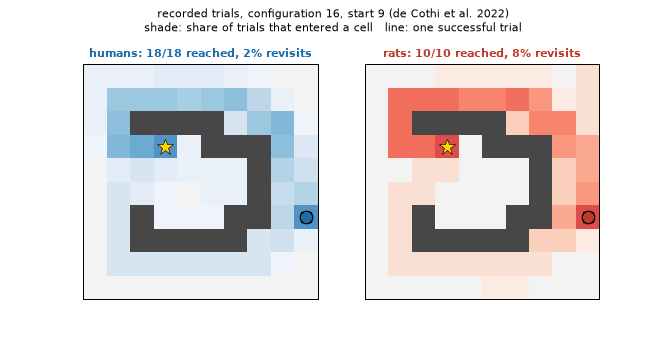 | 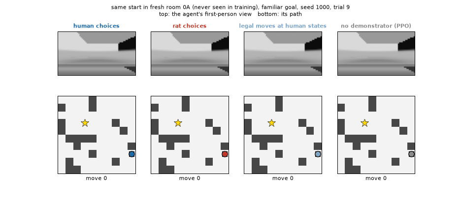 |
| `python play.py animals` | `python play.py agents` |

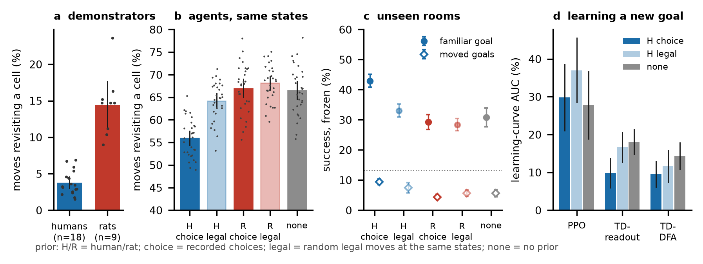

## Results

30 paired seeds · 16 fresh rooms registered before any outcome · 95% CIs · percentage points (pp).
`python tools/check_readme_numbers.py` checks every number below against the records **and** the paper.

| | | |
|---|---|---|
| **Transfer** | frozen agents in never-seen rooms: human choices − legal moves at the same states | **+9.9 pp** [6.9, 12.9] · −8.2 pp revisits · moved goal +2.0 pp |
| **Rats** | rat choices − legal moves | +0.9 pp [−2.7, 4.4] |
| **Forgetting** | old goal kept after learning the new one, with / without a latent-cause gate | **43%** / 4.7% |
| **Brain circuit** | mushroom-body circuit (three-factor rule + awake replay) vs PPO on the new goal, same retention | **+12.4 pp** [3.8, 21.1] · TOST p = .02 |
| **Vision–language–action** | one view predicts the move but not the route · unpaired alignment of networks trained on the same choices | **75%** vs 47% · FOSCTTM 0.06 |
| **Never-seen rooms** (supplement) | hippocampal goal map: new goal there / old goal kept · PPO, new goal there | **83%** / 100% · 28% |
| **Why agents repeat** (supplement, stage 8) | a dopamine dip at *every* visited place: old goal in a never-seen room · new goal | 73 → **100%** (+27.3 [21.4, 33.3]) · 83 → 89% |
| **Animals' own layouts** (supplement) | humans · rats · frozen agents · goal map, old / new goal | 97% · 85% · 55–57% · 66% / 70% |
| **Recorded brains** (supplement) | human hippocampus ↔ human-trained hidden layer vs ↔ the view, beyond space | ρ 0.12 vs 0.01 |

<p>
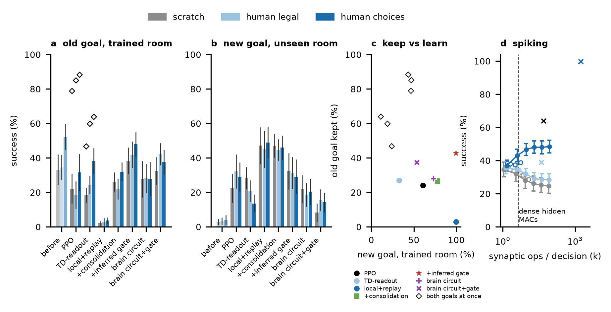<br>
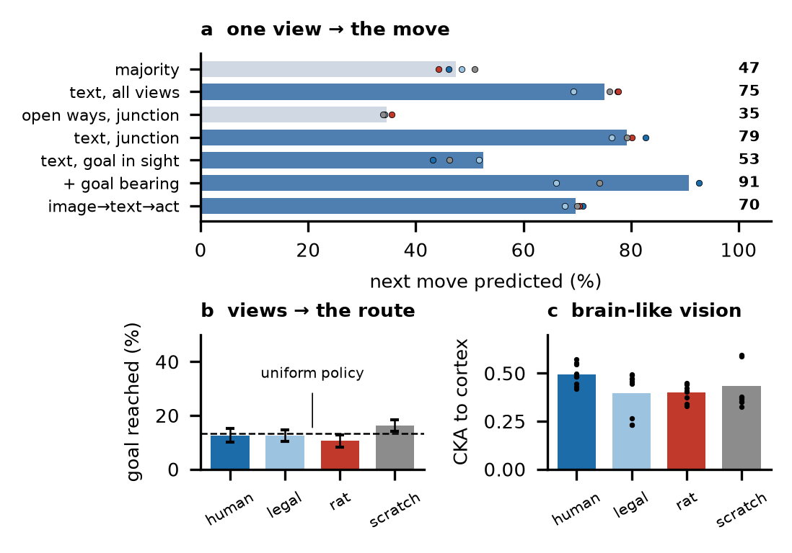 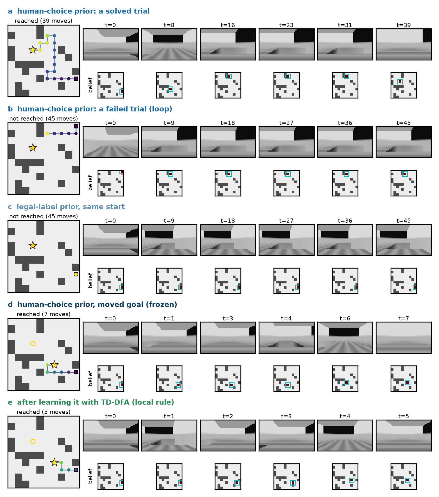
</p>

## Project page

[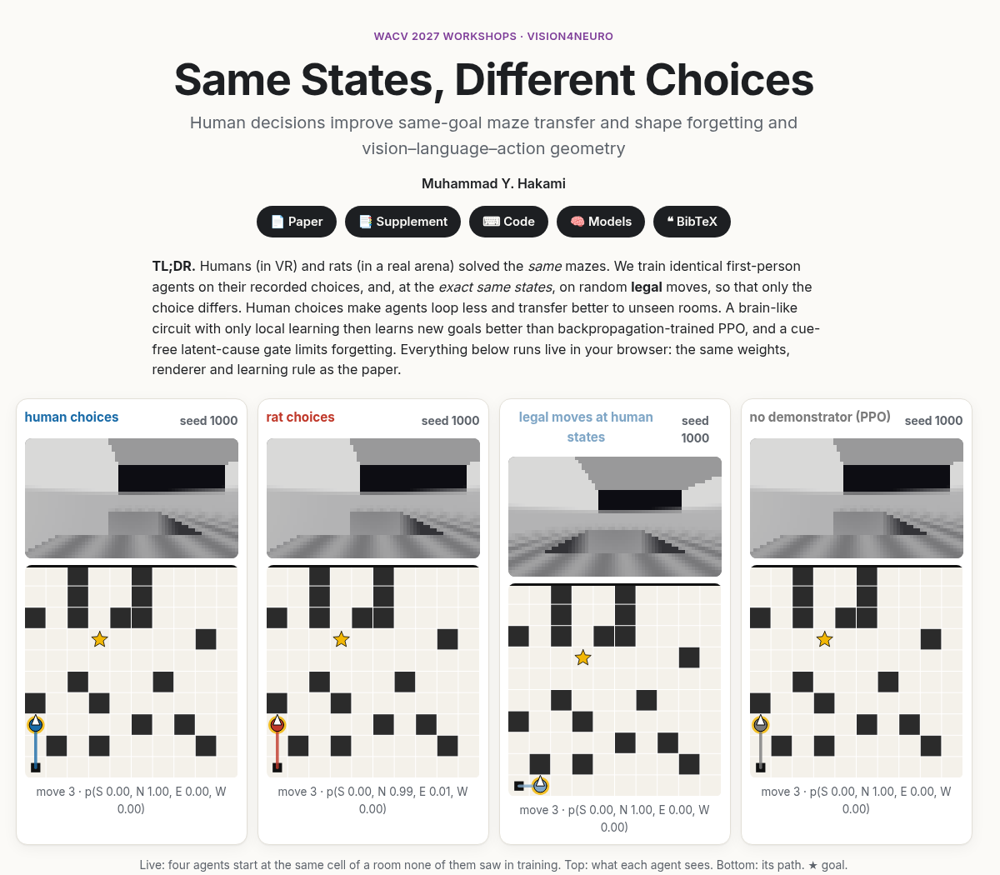](https://muhammadhakami.github.io/human_rat_choices/)

The paper's weights, renderer, place-belief filter and circuit, ported to JavaScript (`site/js/sim.js`) and checked against Python step by step.

| Play: any agents, any room; move the goal, edit walls | Rosetta geometry: distance = 1 − CKA | Recorded brains on the same states |
|:---:|:---:|:---:|
| 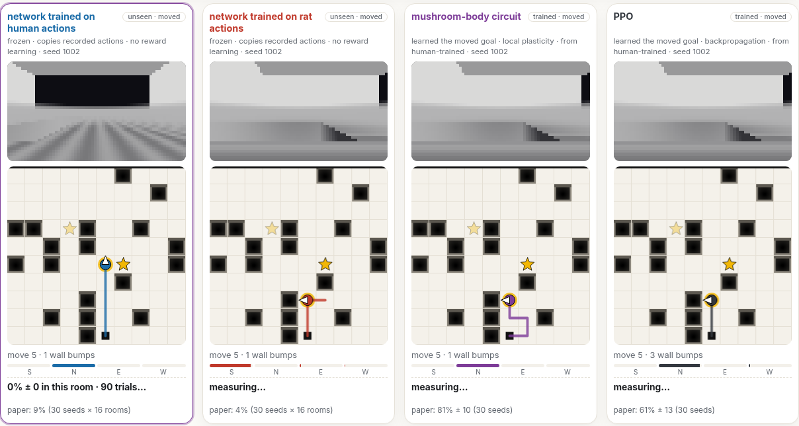 | 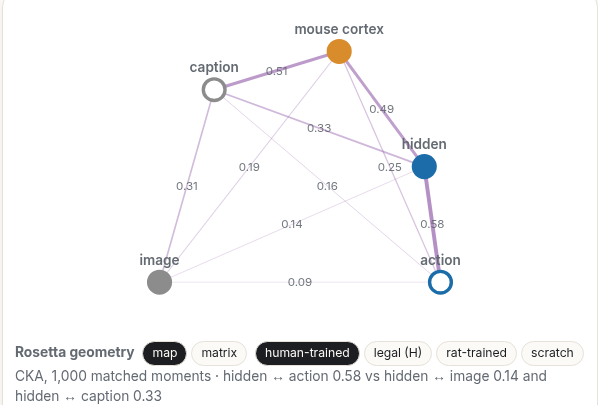 | 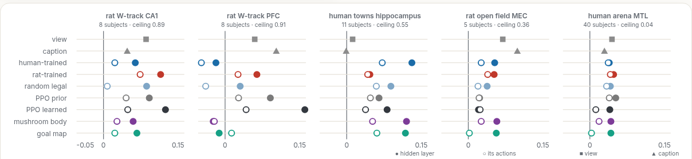 |
| pill = room · goal | hidden ↔ action 0.58, image ↔ action 0.09 | human towns: every network right of view ■ and caption ▲ |

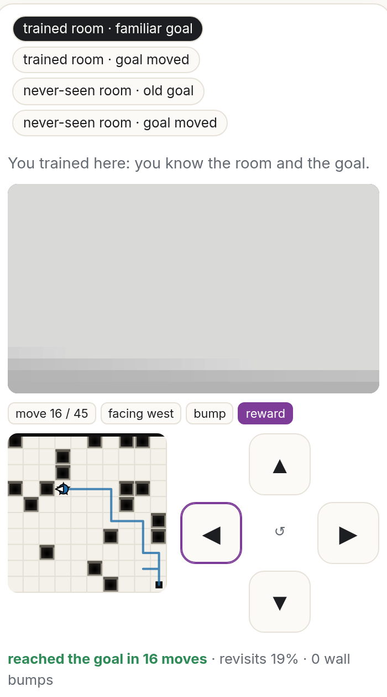

**Your turn**: the task with the agents' information (camera, bump, last move, place belief; 45 moves) in the paper's four tests; the goal is shown only where the agents learned it. Keys or a thumb pad; the reveal scores you against the paper's agents.

Also live: *Inside the model*, *Learn & forget*, *Humans vs rats*, *Same state, different choices*, every chart with every seed, *Asked in review*.

<br clear="right">

## Reproduce

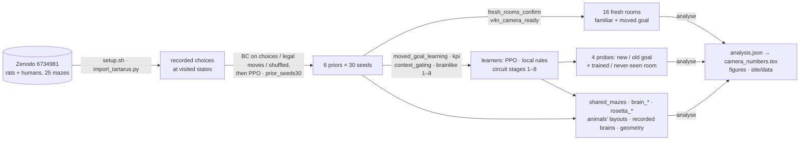

Every study writes `data/audit/<study>/PROTOCOL.json` (script hash, design, predictions) **before** any outcome, then per-seed records, then `analysis.json`. Finished records are never recomputed: a script skips outputs that exist.

### 0 · Install and play (CPU)

```bash
bash setup.sh && source .venv/bin/activate   # venv + raw maze data from Zenodo (81 MB, md5-checked); not redistributed here
python play.py animals                        # people vs rats            -> outputs/animals_*.gif
python play.py agents                         # four agents, same start  -> outputs/agents_*.gif   (~15 s)
```

| Try | |
|---|---|
| another maze or start (25 × 10) | `play.py animals --config 6 --start 4` |
| moved goal · second room of a pair · window · agents · seed | `play.py agents --goal moved` · `--room 3 --unseen` · `--show` · `--models human_bc rat_bc rat_sham cold_ppo` · `--seed 1017` (after `setup.sh --models`) |

### 1 · Numbers, figures, proofs from the shipped records (CPU, minutes)

```bash
python scripts/v4n_camera_numbers_claude.py                       # -> paper/wacv2027/camera_numbers.tex (no number is typed by hand)
for f in story kpi showcase learning diag; do python scripts/figs/fig_camera_${f}_claude.py; done; python scripts/figs/fig_view_route_claude.py
bash scripts/build_v4n_camera.sh                                  # -> both PDFs (pdflatex + bibtex)
(cd proofs && lake build) && (cd proofs_ml && lake exe cache get && lake build)   # Lean 4: 11 theorems, no sorry
python tools/build_site_data.py && bash tools/build_site.sh && python -m http.server -d _site 8000   # the project page
```

### 2 · Train (GPU)

`W N` = worker index / number of workers · `bash setup.sh --models --records` fetches all 180 checkpoints and the large records · times on one RTX 3090.

| Trains | `scripts/…` · commands | |
|---|---|---|
| **priors**: 6 arms × 30 seeds; behaviour cloning on recorded choices, legal moves or shuffled choices, then PPO | `prior_seeds30_claude.py prereg · queue W N` | 3 h |
| **frozen transfer**, 16 fresh rooms | `fresh_rooms_confirm_claude.py check · generate · run main W N · analyse` | 1 h |
| moved goal, greedy readout, loops, belief | `v4n_camera_ready_claude_20261031.py prereg · probe COND W N · bcacc · analyse` | |
| **learning the moved goal**: PPO, local rules | `v4n_moved_goal_learning_claude_20261031.py prereg · calib W N · pick · test W N · analyse` | 3 h |
| forgetting, generalisation, spiking | `v4n_kpi_claude_20261031.py check · kpi W N · snn W N` | |
| latent-cause gate G0 / G1 / G2 | `v4n_context_gating_claude_20261103.py check · prereg · run W N · analyse` | 3 h |
| **brain circuit, stages 1–8** (Optuna on dev rooms, one test per winner) | `v4n_brainlike{,2,…,8}_claude_*.py check · prereg · search W TRIALS · best · test W N · analyse` | test 20–40 min |
| the animals' own layouts 6–25 | `v4n_shared_mazes_claude_20261107.py check · prereg · run W N · analyse` | 1.5 h |
| recorded brains on the same states (sources in each PROTOCOL.json) | `v4n_brain_{mazes,arenas}_claude_*.py check · prereg · collect · analyse` · `v4n_brain_rosetta_claude_20261108.py prereg · analyse` | CPU |
| Rosetta geometry and retrieval (`setup.sh --rosetta`) | `v4n_rosetta_matched_claude_20261031.py check · prereg · moments · features · analyse · closed W N` · `v4n_rosetta_brains_claude_20261103.py prereg · collect · features · jobs W · summary` | |

Stage-2/3 commands assert the registered device (`CUDA_VISIBLE_DEVICES=1`). On the same GPU model a re-run reproduces the records exactly.

### 3 · Validate and test

| Check | Command | Expect |
|---|---|---|
| each study's self-test | `python scripts/<study>.py check` | `check ok` |
| a re-run equals the shipped records | `mv data/audit/v4n_brainlike_20261103/test /tmp/shipped && CUDA_VISIBLE_DEVICES=0 python scripts/v4n_brainlike_claude_20261103.py test 0 1 && python tools/compare_records.py /tmp/shipped data/audit/v4n_brainlike_20261103/test` | `identical 90  different 0` |
| README ↔ records ↔ paper | `python tools/check_readme_numbers.py` | `33/33` |
| theorems | `lake build` in `proofs/`, `proofs_ml/` | no `sorry` |
| browser = Python: one episode, 64 learning steps | `node site/test/parity.mjs` | `parity ok` (≤ 3e-6) |
| 100 reference episodes, step by step | `python tools/golden_many.py && node site/test/parity_many.mjs` | `parity_many ok` |
| learned agents vs their records | `node site/test/learned.mjs` | CIs through 0; stages 7–8 `0.0 pp` |
| frozen agents vs their records | `node site/test/frozen.mjs REF.json` (`{arm: {seed: successes/30}}`) | CI through 0 |
| never-seen rooms leak nothing | `node site/test/leakage.mjs` | cue rows identical (`0.00e+0`) |
| path length, move budget | `node site/test/efficiency.mjs` | `… 14 (budget 45)` |
| why agents loop (stage-8 diagnosis) | `node site/test/loops.mjs` | trapped %, bumps per kind |
| the page in a browser | `node site/test/browser.mjs http://localhost:8000/` | `errors: []` |
| the page on a phone (390 px), *Your turn* by taps | `node site/test/mobile.mjs http://localhost:8000/` | `overflowing elements: []`, `"success":true` |

`tests.yml` runs the CPU checks on every push; `pages.yml` publishes `site/` (Settings → Pages → Source: GitHub Actions).

## Repository

| | |
|---|---|
| `play.py` · `scripts/` · `arc_fly/` | viewer · every experiment, analysis, figure (byte-identical to the registered code) · maze utilities |
| `data/audit/v4n_*` · `data/wacv/seeds30/` | protocols, records, analyses · the six seed-1000 checkpoints |
| `paper/` · `docs/` · `proofs*/` · `site/` · `tools/` | LaTeX + PDFs · protocols, review response · Lean 4 · project page · exporters and checks |

## Data and licences

- **Code:** Apache-2.0.
- **Raw behaviour:** de Cothi et al., *Current Biology* 2022 ([Zenodo 10.5281/zenodo.6734981](https://doi.org/10.5281/zenodo.6734981), "other-open"); downloaded by `setup.sh`, **not redistributed**.
- **Upstream, on request:** [unpaired-rosetta](https://github.com/dominik-schnaus/unpaired-rosetta) (`fdfad84`, MIT); [MICrONS foundation model](https://doi.org/10.1038/s41586-025-08829-y) predictions (supplement only).

```bibtex
@inproceedings{hakami2027samestates,
  title     = {Same States, Different Choices: Human Decisions Improve Same-Goal Maze Transfer and Shape Forgetting and Vision--Language--Action Geometry},
  author    = {Hakami, Muhammad Y.},
  booktitle = {WACV Workshops (Vision4Neuro)}, year = {2027}}
```
